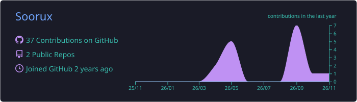
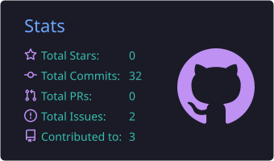
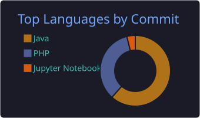

<!-- Cabecera animada -->

  

<!-- Texto que se escribe solo -->

  

  
  
  

---

## 💫 Sobre mí

- 🎓 Estudiante de **2º de Desarrollo de Aplicaciones Multiplataforma (DAM)**
- 💻 Trabajo con **Java**, **Kotlin**, **C#**, **Python**, **PHP** y **JavaScript**
- 📱 Desarrollo apps **Android**, aplicaciones de **escritorio** y proyectos **web**
- 🧵 Ahora mismo aprendiendo **programación concurrente y multihilo** en Java
- 🗄️ Bases de datos relacionales con **PostgreSQL**
- 📚 Preparando mi **TFG** de DAM
- 📫 Puedes contactarme por **LinkedIn** o **email**

---

## 🛠️ Tecnologías

  
    
  

---

## 🚀 Proyectos destacados

| Proyecto | Descripción | Tecnología |
|----------|-------------|------------|
| 📋 [**GestorDeTareasDevOps**](https://github.com/Soorux/GestorDeTareasDevOps) | Gestor de tareas por consola con menú interactivo: crear, completar, listar y eliminar tareas. |  |
| 📂 [**java-Ficheros**](https://github.com/Soorux/java-Ficheros) | Ejercicios de lectura y escritura de ficheros en Java. |  |
| 🌐 [**institemp**](https://github.com/Soorux/institemp) | Proyecto web con PHP. |  |
| 🧠 [**Logica**](https://github.com/Soorux/Logica) | Ejercicios de lógica y algoritmia en notebooks. |  |

---

## 📊 Estadísticas

  

  
  

  

---

## 🐍 Mis contribuciones

  <picture>
    <source media="(prefers-color-scheme: dark)" srcset="https://raw.githubusercontent.com/Soorux/Soorux/output/github-snake-dark.svg" />
    <source media="(prefers-color-scheme: light)" srcset="https://raw.githubusercontent.com/Soorux/Soorux/output/github-snake.svg" />
    
  </picture>

<!-- Pie animado -->

  

